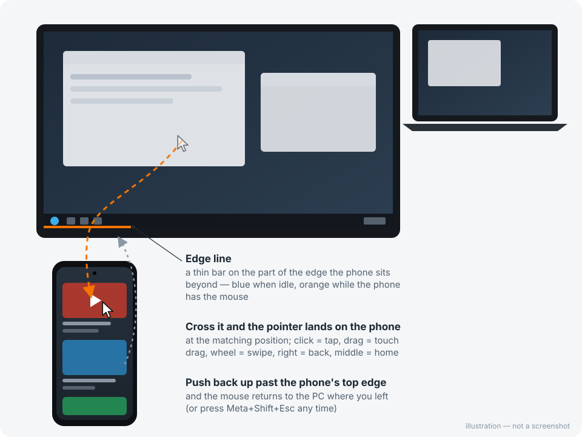
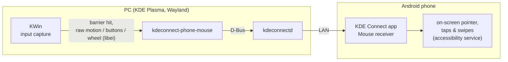

# kdeconnect-phone-mouse

Use your Android phone as if it were another monitor, for the mouse only.
Push the pointer off a screen edge on your KDE Plasma desktop and it continues
on the phone. Click, drag and scroll there, then push back to return to the PC.

No app to install on the phone beyond KDE Connect. No adb, no root, no
permission dialog. The phone is reached over the KDE Connect link you already
have.



## Features

- **Edge crossing** on any edge of any screen, optionally limited to part of
  that edge (where the phone actually sits).
- **Position mapping**: crossing at the left end of the edge lands at the
  left of the phone, and returning puts the PC pointer back at the matching
  spot.
- **Edge line**: a thin click-through bar marks the crossing area. It is blue
  when idle and orange while the phone has the mouse.
- **Phone input**: click = tap, drag = touch drag, wheel = swipe under the
  pointer, right click = Back, middle click = Home.
- **Only while connected**: the edge is armed only while KDE Connect reports
  the phone reachable. Otherwise the screen edge behaves normally.
- **Only while charging** (optional, `--require-charging`): arm the edge only
  while the phone charges, e.g. sits on its charging stand.
- **Survives monitor changes**: when the screen layout changes, the service
  restarts with the new layout.

## How it works



1. The script asks KWin for an input capture with a pointer barrier on the
   chosen stretch of a screen edge.
2. When you push through the barrier, KWin hands the pointer to the script:
   the PC cursor stops, and raw relative motion arrives over libei.
3. The script forwards motion, clicks and wheel to the phone through KDE
   Connect's `remotecontrol` D-Bus API. On the phone, KDE Connect's
   **Mouse receiver** plugin draws a pointer and performs taps and swipes.
4. The script tracks the phone pointer. When you push back out of the edge
   you came in through, it releases the capture at the matching PC position.

## Requirements

| Side | Needs |
|---|---|
| PC | KDE Plasma **6.6** on **Wayland** (tested: Kubuntu 26.04, Plasma 6.6.6), KDE Connect, Python 3, `python3-dbus`, `python3-gi`, `libei1`, `kscreen-doctor` (`libkscreen-bin`) |
| PC, for the edge line | `gir1.2-gtklayershell-0.1`, `python3-gi-cairo` |
| Phone | KDE Connect for Android, paired with the PC; Android 8+ for drag |

Debian / Ubuntu:

```bash
sudo apt install python3-dbus python3-gi python3-gi-cairo libei1 \
                 gir1.2-gtklayershell-0.1
```

## Setup

### Phone (once)

1. KDE Connect → your PC → ⋮ → **Plugin settings** → turn on
   **Mouse receiver**.
2. Grant its accessibility permission when asked. If it doesn't ask:
   Settings → Accessibility → Downloaded apps → KDE Connect → on.
3. Let KDE Connect run in the background (battery optimisation off).
   Some vendor ROMs (ColorOS, MIUI, …) otherwise turn the accessibility
   service off.

### PC

```bash
git clone https://github.com/marosmars/kdeconnect-phone-mouse
cd kdeconnect-phone-mouse
./install.sh
```

This installs the script to `~/.local/bin`, a systemd user service that starts
with your Plasma session, and a config file at
`~/.config/kdeconnect-phone-mouse.conf`. By default the phone is to the right
of your rightmost screen.

Tell it where your phone actually is, then restart:

```bash
$EDITOR ~/.config/kdeconnect-phone-mouse.conf
systemctl --user restart kdeconnect-phone-mouse
```

To try it without the service, stop the service first, then run it in a
terminal:

```bash
kdeconnect-phone-mouse --edge bottom --span 0,0.25
```

Uninstall: `./install.sh --uninstall`.

## Configuration

All options are command-line flags. For the service, put them in `ARGS=` in
`~/.config/kdeconnect-phone-mouse.conf`.

| Option | Default | Meaning |
|---|---|---|
| `--edge` | `right` | Screen edge the phone sits beyond: `left`, `right`, `top`, `bottom` |
| `--zone X,Y` | outermost screen on that edge | Any point on the screen the phone sits next to (see `kscreen-doctor -o`) |
| `--span FROM,TO` | `0,1` | Part of that edge, as fractions, left-to-right or top-to-bottom. `0,0.25` = first quarter |
| `--phone-w`, `--phone-h` | `1080`, `2400` | Phone screen resolution in pixels (portrait) |
| `--scale` | `2.0` | Phone pixels per PC pixel of mouse motion |
| `--scroll` | `250` | Swipe length per wheel notch, phone pixels |
| `--settle` | `4` | Hold-still steps before lifting the finger. `0` lets lists fling |
| `--return-push` | `150` | How far (phone px) to push out of the phone before returning |
| `--line` | `3` | Edge line thickness in px, `0` hides it |
| `--require-charging` | off | Arm the edge only while the phone is charging (KDE Connect battery plugin must be on) |
| `--device` | the only paired device, else the only reachable one | KDE Connect device id, from `kdeconnect-cli -l` |

Example: phone lying below the left quarter of the screen at 0,0:

```
ARGS=--edge bottom --zone 0,0 --span 0,0.25 --phone-w 1440 --phone-h 3120
```

## Getting your mouse back

- Push back out of the phone through the edge you came in.
- **Meta+Shift+Esc** always releases the pointer (KWin's built-in escape).
  The edge re-arms a second later.
- The keyboard is never captured, so stopping the service always works:
  `systemctl --user stop kdeconnect-phone-mouse`.

## Limitations

- **Plasma only.** It uses KWin's input capture D-Bus interface
  (`org.kde.KWin.EIS.InputCaptureManager`) directly. That interface is
  internal and may change between Plasma releases (both the 6.6 and the
  current development signatures are handled). Check
  `journalctl --user -u kdeconnect-phone-mouse` after an upgrade.
  The public InputCapture portal would avoid that, but on Plasma 6.6 it asks
  permission on every start, shows a notification on every crossing, and only
  accepts barriers that span a whole screen edge.
- **Pointer only.** The keyboard stays on the PC.
- **Scrolling is swipe-based.** Each wheel notch is a short swipe under the
  pointer. KDE Connect's own scroll command scrolls the first scrollable view
  on screen instead (on YouTube, the seek bar).
- **Latency** is what KDE Connect over Wi-Fi gives you: fine for tapping
  around, not for games.
- The phone pointer position is estimated on the PC side. If you also touch
  the phone, the next crossing re-syncs it.

## Related

KDE Connect has an upstream feature with the same goal: the desktop
`shareinputdevices` plugin plus the Android "Input devices receiver". At the
time of writing, distribution packages often don't ship the desktop plugin.
It needs a whole screen edge, and scrolls with the same scroll command
described above. If it's available to you, try it too.

## License

[MIT](LICENSE)
